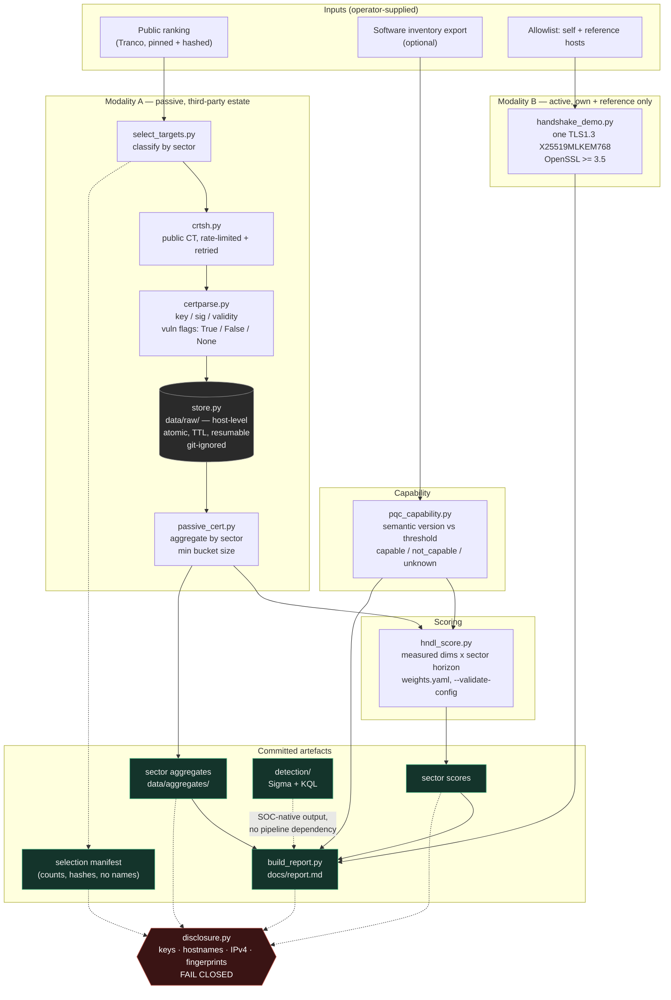
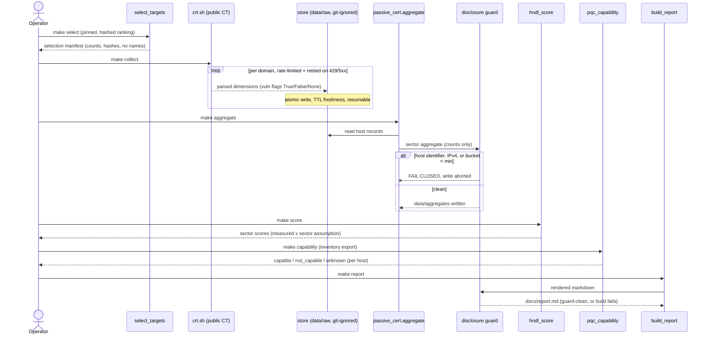

# PQC Crypto-Agility Assessment

> Certificate dimensions come from public data. PQC readiness is demonstrated
> actively only against own and reference infrastructure. Third-party estate is
> never touched actively.

## Thesis

The EU deadline of 2026-12-31 for initial national PQC roadmaps is five months
out. The bottleneck in that migration is not cryptography. It is inventory:
identifying every place where vulnerable cryptography is in use. That is a data
engineering and telemetry problem, not a lattice problem.

So this repository does not sell a finding. "X% of domains in sector Y still
serve RSA" is trivial to produce and trivial to reproduce. What is not trivial
is a repeatable pipeline, an explicit provenance layer, and a detection layer
that puts the result in front of a SOC in language it already uses.

## Regulatory anchors `[measured]`

| Date | Event |
|---|---|
| 2024-04-11 | Commission Recommendation (EU) 2024/1101 on a coordinated implementation roadmap for the transition to PQC |
| 2024-08 | NIST FIPS 203 (ML-KEM), 204 (ML-DSA), 205 (SLH-DSA) finalised |
| 2025-06-23 | Member States publish the Coordinated Implementation Roadmap |
| 2026-12-31 | Initial national roadmaps and first steps: identification, awareness |
| 2030-12-31 | High-risk use cases migrated; quantum-safe upgrades as default |
| 2035-12-31 | Full transition |

The 2030 milestone carries the sharpest formulation: for high-risk use cases,
quantum-vulnerable public-key mechanisms must not be used on their own beyond
the end of 2030. Risk holders in scope: NIS2 entities, financial sector under
DORA.

Reference hybrid group: `X25519MLKEM768`, IANA codepoint `0x11EC`, naming per
RFC 9794. Default in OpenSSL 3.5 (LTS through April 2030). PQC algorithm
identifiers in X.509 per RFC 9881 (ML-DSA) and RFC 9935 (ML-KEM).

## Modalities

The collection design is split cleanly, and the split is enforced in code and
in directory layout rather than in prose.

**Modality A, passive, third-party estate.** Certificate Transparency via
crt.sh. Zero packets toward any target host. Measured dimensions: public key
algorithm and parameter, signature algorithm, validity window, whether validity
outlives the 2030 milestone, PQC algorithm identifiers where present. Output is
aggregated by sector only, with a minimum bucket size enforced at aggregation
time. No organisation name is ever emitted next to a vulnerability label.

**Modality B, active, own and reference infrastructure only.** One TLS 1.3
handshake per target offering `X25519MLKEM768`, reading back the negotiated
group and inferring HelloRetryRequest. Targets must appear in an allowlist file
under `self` or `reference`; `active/handshake_demo.py` refuses anything else
before opening a socket. Reference hosts are public implementations serving
internet-scale traffic, used as positive controls for the method itself.

**Modality rejected: mass active sweep of third-party estate.** Rationale kept
in `docs/methodology.md`. Short version: a single handshake and an nmap run
generate comparable traffic and carry opposite optics, the marginal signal was
near zero, and the downside was asymmetric.

## Architecture

The diagram is the pipeline as built: solid arrows are data flow, dashed arrows
are enforcement. Everything above `data/raw/` is host-level and never committed;
only sector aggregates and the selection manifest cross into the committed zone.
The disclosure guard sits on that boundary and fails closed.



Reading it in one line: a pinned public ranking defines the denominator, passive
collection reads public CT into a host-level store that never leaves the
machine, aggregation collapses it to sectors, scoring folds in the one named
assumption (sector horizon), and nothing reaches the committed zone without
clearing the disclosure guard. Modality B and the capability resolver feed the
same report along independent paths; the detection pack stands alone, consumed
by a SOC rather than by this pipeline.

## Runtime mechanism

The Architecture diagram above is static structure; this one is behaviour over
time — what actually happens, in order, when a run executes. It is the six
`make` targets as a sequence, including the two places the run can stop itself:
the rate-limited collection loop and the fail-closed disclosure guard.



Each participant maps to the module that implements it and the section of
`docs/mechanisms.md` that explains it; that mapping table is kept in
`mechanisms.md` so the diagram and the prose cannot drift apart.

## Provenance convention

Three labels, used in code, in output records and in the report:

- `[measured]` data read from a certificate, a handshake or a log, without interpretation
- `[inference]` risk classification derived from observable proxies
- `[speculation]` explicitly uncertain, carried through rather than resolved

A composite value inherits the weakest label of its inputs. The HNDL score is
therefore an inference, not a measurement, and says so in its own output.

Ambivalent signals stay open. Where a result could be a collection artefact or
a real change in posture, the record says so instead of picking the tidier
reading.

## HNDL scoring

Built only from observable proxies, because no data classification is available
and pretending otherwise would be the most consequential lie in the artefact.

Inputs: certificate key algorithm `[measured]`, signature algorithm
`[measured]`, validity window `[measured]`, PQC indicators where observable
`[measured]`, and sector confidentiality horizon `[assumption]`.

Output: years of exposure projected onto the 2030 milestone, plus a weighted
composite with per-component contributions so the number can be argued with.

All weights, horizons and thresholds live in `scoring/weights.yaml`. If you find
one hardcoded in `scoring/hndl_score.py`, that is a bug. The sector
confidentiality horizon is the load-bearing assumption of the entire model and
is labelled as such in the config, in the code and in every output record.

The saturation cap for the exposure term is derived from the longest configured
horizon rather than set independently, because those two numbers silently had
to agree and did not: a fixed cap of 20 years against a 30-year horizon
collapsed healthcare, defence and government onto an identical score on a
component carrying weight 0.30. `make validate` now fails on that class of
config drift, and CI runs it.

No Q-Day estimate enters the arithmetic. The model is anchored to a regulatory
milestone, which is observable, rather than to a forecast, which is not.

## Detection layer

Sigma rules and KQL queries that surface vulnerable cryptography in enterprise
telemetry: TLS handshake logs, Microsoft Sentinel and Defender tables, crypto
library inventory, Key Vault key material. See `detection/README.md`, which
includes an explicit validation-status table separating what was verified
locally from what was taken from vendor documentation.

## What this assessment will not tell you

Stated up front, because the gap between what a passive assessment measures and
what a migration programme needs is where most vendor content quietly lives.

- It does not see cryptography at rest.
- It does not see HSMs.
- It does not see internal PKI, except indirectly through endpoint certificate inventory in the detection layer.
- It does not see code, embedded libraries, or pinned certificates in applications.
- It does not see the negotiated key exchange group of third-party services. PQC readiness of key agreement is not observable from certificate data. It requires an active handshake, which this project does not perform against third-party estate.
- A certificate that uses RSA says nothing about whether that service already negotiates a hybrid group. These are different layers and conflating them is the most common error in this space.

## Ethics and scope statement

Every rule below is enforced by code, and the enforcement runs in CI. A scope
statement that lives only in a README is a scope statement that survives until
the first inconvenient deadline.

- Third-party estate: public data only, Certificate Transparency and equivalent public sources. No active traffic, no scanning, no enumeration.
- Active handshakes: own infrastructure and public reference implementations only, enforced by allowlist in `active/handshake_demo.py`, which refuses an undeclared target before opening a socket. One handshake per target.
- A single handshake to a documented reference implementation is not reconnaissance. It is the same connection a browser makes, made once, on purpose, with the result written down.
- Aggregation by sector, minimum bucket size enforced by `collectors/disclosure.py`. Buckets below the threshold are dropped, not reported with n=1.
- No organisation is named next to a vulnerability finding. `assert_no_host_identifiers` rejects forbidden keys, hostname-shaped strings, IPv4 literals and certificate fingerprints in anything written to `data/aggregates/` or `docs/`.
- Host-level raw data stays in `data/raw/`, which is git-ignored. Only sector aggregates are committed.
- Target lists are not committed. `config/targets.yaml` is git-ignored, and `tests/lint_disclosure.py` fails the build if it ever becomes tracked.

Certificate SHA-256 fingerprints are treated as host identifiers, not as
metadata. A fingerprint resolves back to a domain through the same public CT
logs the data came from, so publishing one re-identifies the host that the
sector aggregation was supposed to protect.

## Layout

```
pqc-crypto-agility-assessment/
├── collectors/          # Modality A: passive, third-party, public data only
│   ├── crtsh.py         #   CT client, rate limited, backoff, retry
│   ├── certparse.py     #   X.509 dimension extraction, PQC OID aware
│   ├── store.py         #   idempotent per-host store, atomic writes
│   ├── disclosure.py    #   scope statement as an executable guard
│   ├── select_targets.py#   ranking -> targets + committed selection manifest
│   └── passive_cert.py  #   CLI: collect, then aggregate to sector level
├── active/
│   └── handshake_demo.py# Modality B: allowlisted targets only, preflight gated
├── scoring/
│   ├── hndl_score.py    #   scoring engine, no hardcoded constants
│   └── weights.yaml     #   weights, sector horizons, thresholds, assumptions
├── inventory/
│   └── pqc_capability.py#   software inventory -> capability verdicts, version aware
├── reporting/
│   └── build_report.py  #   aggregates -> docs/report.md, cannot read raw data
├── detection/
│   ├── sigma/           #   Zeek and Windows inventory rules
│   └── kql/             #   Defender, Sentinel, Resource Graph queries
├── config/
│   ├── targets.example.yaml
│   ├── classification.yaml   # sector rules, hashed into the manifest
│   ├── pqc_capability.yaml   # library thresholds, provenance-labelled
│   └── reference_hosts.yaml  # active-probe allowlist
├── data/
│   ├── raw/             #   host level, git-ignored
│   └── aggregates/      #   sector level, committed
├── docs/
│   ├── methodology.md
│   ├── mechanisms.md    #   how each mechanism works
│   └── report.md        #   generated
├── tests/
│   ├── conftest.py           # puts repo root on sys.path once
│   ├── test_pipeline.py
│   ├── test_sprint2.py
│   ├── test_collection.py
│   ├── test_capability.py
│   ├── test_handshake.py
│   ├── test_sprint6.py
│   ├── validate_sigma.py
│   └── lint_disclosure.py
├── pyproject.toml            # installable, console scripts, coverage config
└── .github/workflows/ci.yml
```

The separation between `collectors/` and `active/` is load bearing. Targets are
never mixed between the two.

## Running it

### Prerequisites

- Python 3.11 or newer (`python3 --version`).
- For the active probe only: OpenSSL 3.5 or newer (`openssl version`). Every
  other stage runs without it.
- Network egress to `crt.sh` for passive collection. Nothing else phones home.

### Install

```bash
git clone <your-remote>/pqc-crypto-agility-assessment.git
cd pqc-crypto-agility-assessment

python3 -m venv .venv && source .venv/bin/activate
make install        # editable install + dev extras (pytest, pytest-cov, pysigma)
```

`make install` runs `pip install -e ".[dev]"`. That puts the six `pqc-*`
console scripts on your PATH and removes any need to invoke modules by file
path. Confirm:

```bash
pqc-score --help
make verify         # tests + coverage floor + Sigma structure + config + disclosure lint
```

If `make verify` is green you have a working install. It runs exactly what CI
runs, so green here means green there.

### Stage 1 — select the sample (defines your denominator)

A percentage is meaningless without a stated denominator, so selection is a
first-class step that records itself. Pin a public ranking file (Tranco or
equivalent, `rank,domain` CSV) by hash, then classify it.

```bash
pqc-select --ranking tranco_2026_07.csv --suffix .pl --top 10000
# or: make select RANKING=tranco_2026_07.csv SUFFIX=.pl TOP=10000
```

Outputs:
- `config/targets.yaml` — the working target list, git-ignored.
- `data/aggregates/selection_manifest.json` — committed, hashes and per-sector
  counts, no domain names. This is what a reviewer challenges instead of the
  sample itself.

Watch the console for a rule-collision warning. If a domain matched more than
one sector, the manifest records it; narrow the token in
`config/classification.yaml`, do not reorder it. Sector keys there must match
the keys in `scoring/weights.yaml`.

Skip this stage if you are supplying `config/targets.yaml` by hand. Its shape:

```yaml
sectors:
  finance:    [example-bank.pl, another-bank.pl]
  healthcare: [example-clinic.pl]
```

### Stage 2 — passive collection (third-party estate, public data only)

```bash
pqc-collect --targets config/targets.yaml -v
# or: make collect
```

This queries Certificate Transparency via `crt.sh`, fetches the current leaf
certificates and parses their dimensions into `data/raw/certs/<host>.json`. The
raw store is git-ignored, host-level, resumable: rerun it and hosts still fresh
(7-day TTL) are skipped. It sends zero packets to any target host.

`crt.sh` is a free community service and rate-limits; the client backs off and
retries. A large target list takes a while. Then aggregate to sector level:

```bash
pqc-collect --aggregate-only     # or: make aggregate
```

Produces `data/aggregates/sectors.json`. Sectors with fewer hosts than
`--min-bucket` (default 5) are dropped, not reported with n=1. The write is
refused outright if any host identifier would leak into the aggregate.

### Stage 3 — HNDL scoring

```bash
pqc-score --from-store          # or: make score
```

Reads the raw store, applies the model in `scoring/weights.yaml`, writes
`data/aggregates/hndl_sector_scores.json` (sector level). Two diagnostics:

```bash
pqc-score --validate-config     # saturation, floors, weight and band sanity; make validate
pqc-score --explain '{"sector":"finance","key_quantum_vulnerable":true,
  "signature_quantum_vulnerable":true,"valid_beyond_2030_milestone":true,
  "validity_days":398}'         # full per-component breakdown for one subject
```

`--validate-config` exits non-zero on an error-severity issue (e.g. a fixed cap
that saturates the top sectors) and is one of the CI gates. Edit weights and
horizons in the YAML; nothing is hardcoded in the scorer.

### Stage 4 — endpoint capability (optional, needs an inventory export)

Answers "on how many hosts can the crypto stack even negotiate a hybrid group",
which decides whether a finding is a policy ticket or an upgrade ticket. Input
is a software-inventory CSV (Defender `DeviceTvmSoftwareInventory` export or
similar) with device, name, vendor and version columns.

```bash
pqc-capability --inventory software_export.csv     # make capability INVENTORY=...
pqc-capability --check openssl 3.4.1               # resolve a single pair, prints the verdict
```

Writes `data/aggregates/pqc_capability.json`. Verdicts are `capable`,
`not_capable`, or `unknown` for libraries whose threshold is not verified.
Thresholds and their provenance live in `config/pqc_capability.yaml`. Device
identifiers are counted and discarded, never written.

### Stage 5 — active PQC demonstration (own + reference hosts only)

```bash
openssl version                 # must be >= 3.5
pqc-handshake --allowlist config/reference_hosts.yaml    # make handshake
```

One TLS 1.3 handshake per allowlisted host offering `X25519MLKEM768`, reading
back the negotiated group. The probe refuses any host not in the allowlist
before opening a socket, and refuses to run at all below OpenSSL 3.5 (a negative
result from an old client would measure the client, not the server). Add your
own infrastructure under `self` and keep the reference implementations under
`reference`. To keep a raw transcript for audit:

```bash
pqc-handshake --allowlist config/reference_hosts.yaml --capture-dir captures/
```

Captures stay out of version control.

### Stage 6 — the report

```bash
pqc-report                      # or: make report
```

Renders `docs/report.md` from the committed aggregates only. This generator has
no access to the raw host store by construction, so it cannot leak host data,
and it scans its own output for host-like strings before writing. Missing
inputs degrade to an explicit "no data" section rather than a silent gap; a
missing selection manifest produces a "no denominator reported" note instead of
an unbacked percentage.

### One-shot

With `config/targets.yaml` in place:

```bash
make collect aggregate score report
```

### Troubleshooting

- `command not found: pqc-score` — the venv is not active, or `make install`
  was skipped. `source .venv/bin/activate` then `make install`.
- `crt.sh unreachable after N attempts` — the service is rate-limiting or down.
  Raise `--rate` (seconds between calls) and rerun; the store resumes.
- `preflight failed: OpenSSL 3.0.x cannot offer X25519MLKEM768` — expected on
  older OpenSSL. Only Stage 5 needs 3.5; everything else runs regardless.
- `DisclosureViolation` on report or aggregate — a host identifier reached
  output. That is the guard doing its job; do not suppress it, find the leak.
- Coverage below the floor — logic coverage regressed. `make coverage` shows
  the missing lines.

## Status

Sprint 1: passive collection, scoring engine, detection rule pack, provenance
plumbing.

Sprint 2: sampling with a hashed, auditable selection manifest and rule
collision detection; the exposure-cap fix described above; the scope statement
turned into an executable guard with its own lint; report generation; CI.

Sprint 3: test coverage for the collection transport and its failure modes;
endpoint capability resolution with real semantic version comparison, replacing
the bucket the KQL query could not resolve; capability section in the report.

Sprint 4: handshake output parser split from the subprocess call and tested
against synthetic transcripts, closing the largest untested surface without a
3.5 client; optional real-transcript capture for audit; `TODO.md`, `LICENSE`,
`CONTRIBUTING.md`; disclosure lint widened to the root prose files.

Sprint 5: verified capability thresholds for GnuTLS (3.8.8) and wolfSSL (5.8.0)
with references (NSS and LibreSSL verified later, in sprint 7); packaged with
`pyproject.toml` and six `pqc-*` console scripts, `pip install -e .`, path hacks
removed from tests via `conftest.py`; coverage measured with an honest floor in
CI; this runbook.

Sprint 6: correctness review of the shipped tree, which found three defects that
produced plausible wrong numbers rather than failures. Unidentified key and
signature algorithms were reported as post-quantum rather than unknown, which
inflated PQC-adoption counts in the direction that flatters the estate; the
flags are now tri-state. A truncated version string (`3.5` against a `3.5.0`
threshold) resolved an upgraded host as `not_capable`. The disclosure guard
could not see IPv4 literals at all. Each fix carries a regression test that
fails against the previous release. Coverage floor raised 65 to 70;
`docs/mechanisms.md` added.

Sprint 7: capability thresholds for NSS (3.118) and LibreSSL verified against primary sources, closing the last `null` entries with real values. LibreSSL has no PQC in any released version through 3.9, which is a measured negative, not merely unknown; the resolver now expresses that through `pqc_absent_through` so a confirmed absence at or below the verified version reports `not_capable` while a newer release stays `unknown`.

Open items live in `TODO.md`, each with a status, a blocker where applicable,
and an acceptance test.

## Licensing

Dual-licensed: **AGPL-3.0-only** (see [`LICENSE`](./LICENSE)) **or** a commercial
license from the author. Running a modified version as a network service under
AGPL-3.0 obliges you to release your source (AGPL section 13); a commercial
license waives that. Details and contact in [`LICENSING.md`](./LICENSING.md).

Copyright (c) 2026 Jerzy Siwecki.
