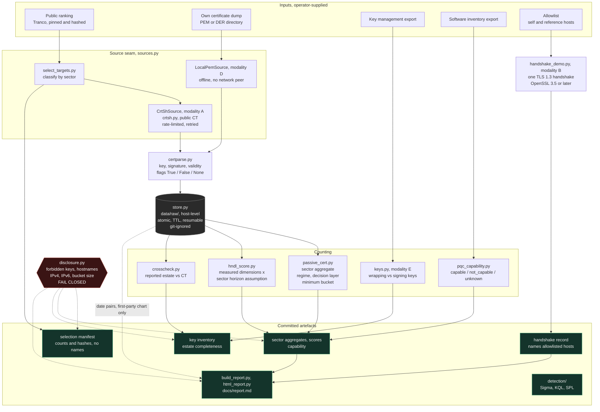
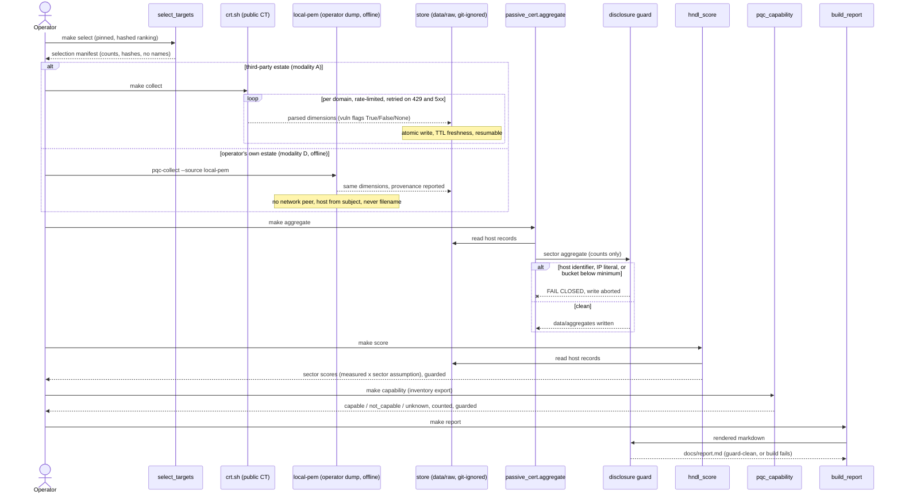

# PQC Crypto-Agility Assessment

### Codename: ANANKE

[](https://github.com/jerzy99jerzy/pqc-crypto-agility-assessment/actions/workflows/ci.yml)

> Certificate dimensions come from public data. PQC readiness is demonstrated
> actively only against own and reference infrastructure. Third-party estate is
> never touched actively.

Release criteria and the definition of done for each intended audience live in
[`docs/MVP.md`](./docs/MVP.md). The codename is explained under
[On the name](#on-the-name).

## Thesis

The EU milestone for initial national PQC roadmaps is 2026-12-31. The
bottleneck in the migration it opens is inventory, not cryptography: finding
every place where quantum-vulnerable public-key cryptography is in use. That is
a data engineering and telemetry problem.

A headline such as "X% of domains in sector Y still serve RSA" is cheap to
produce and cheap to reproduce. The work in this repository is the part that
has to be built and maintained: a repeatable pipeline, an explicit provenance
layer, and a detection layer that puts the result in front of a SOC in the
query languages it already runs. [`docs/COMPETITORS.md`](./docs/COMPETITORS.md)
records which of those parts also exist elsewhere.

## Regulatory anchors `[measured]`

| Date | Event |
|---|---|
| 2024-04-11 | [Commission Recommendation (EU) 2024/1101](https://eur-lex.europa.eu/eli/reco/2024/1101/oj) on a coordinated implementation roadmap for the transition to PQC |
| 2024-08-13 | NIST [FIPS 203](https://csrc.nist.gov/pubs/fips/203/final) (ML-KEM), [204](https://csrc.nist.gov/pubs/fips/204/final) (ML-DSA) and [205](https://csrc.nist.gov/pubs/fips/205/final) (SLH-DSA) published |
| 2025-06-23 | [Coordinated Implementation Roadmap](https://digital-strategy.ec.europa.eu/en/library/coordinated-implementation-roadmap-transition-post-quantum-cryptography) published by the NIS Cooperation Group |
| 2026-12-31 | Initial national roadmaps and first steps: identification, awareness |
| 2030-12-31 | High-risk use cases migrated; quantum-safe upgrades enabled by default |
| 2035-12-31 | Full transition |

The roadmap's sharpest wording is on the 2030 milestone: for high-risk use
cases, quantum-vulnerable public-key mechanisms are not to be used stand-alone
after the end of 2030. Risk holders in scope: NIS2 entities and the financial
sector under DORA.

Reference hybrid group: `X25519MLKEM768`, TLS supported-groups codepoint
`0x11EC`, registered by
[draft-ietf-tls-ecdhe-mlkem](https://datatracker.ietf.org/doc/draft-ietf-tls-ecdhe-mlkem/),
with hybrid terminology per [RFC 9794](https://www.rfc-editor.org/rfc/rfc9794).
It is a default key share in OpenSSL 3.5, an LTS release supported to April
2030. PQC algorithm identifiers in X.509 follow
[RFC 9881](https://www.rfc-editor.org/rfc/rfc9881) (ML-DSA) and
[RFC 9935](https://www.rfc-editor.org/rfc/rfc9935) (ML-KEM).

## Modalities

The collection design is split by modality, and the split is enforced in code
and in directory layout. Each letter matches the modality tag the code writes
into its output records; C is unassigned.

**Modality A, passive, third-party estate.** Certificate Transparency via
crt.sh. Zero packets toward any target host. Measured dimensions: public key
algorithm and parameter, signature algorithm, validity window, whether validity
outlives the configured milestone, PQC algorithm identifiers where present.
Output is aggregated by sector only, with a minimum bucket size enforced at
aggregation time. No organisation name is ever emitted next to a vulnerability
label.

**Modality B, active, own and reference infrastructure only.** One TLS 1.3
handshake per target offering `X25519MLKEM768`, reading back the negotiated
group and inferring HelloRetryRequest. Targets must appear in an allowlist file
under `self` or `reference`, and `ananke/active/handshake_demo.py` refuses
anything else before opening a socket. Reference hosts are public
implementations serving internet-scale traffic, used as positive controls for
the method itself. No `self` host is declared yet, so the method has been
demonstrated against reference implementations only (T2 in `TODO.md`).

**Modality D, the operator's own certificates, offline.** A directory of PEM or
DER files parsed with the same code and no network peer. Every field is
measured; that the directory is the whole estate is the operator's claim, so
the set carries `reported` provenance. `pqc-crosscheck` compares it with the
same operator's public CT footprint, the one control available on that claim.

**Modality E, at-rest key inventory, reported.** `pqc-keys` reads an export the
operator produces from their own key management service and emits counts.

**Rejected: mass active sweep of third-party estate.** Rationale in
[`docs/DECISIONS.md`](./docs/DECISIONS.md). A single handshake and an nmap run
generate comparable traffic and carry opposite optics, the marginal signal was
near zero, and the downside was asymmetric.

## Architecture

The diagram is the pipeline as built. Solid arrows are data flow, dashed arrows
are enforcement. Everything in the raw store is host-level and never committed;
only counts cross into the committed zone, and every writer that produces them
calls the disclosure guard first. The component view, with a block-to-document
index, is in [`docs/ARCHITECTURE.md`](./docs/ARCHITECTURE.md).



Read in one line: a pinned public ranking defines the denominator, passive
collection or an offline dump fills a host-level store that never leaves the
machine, counting collapses it to sectors, scoring folds in the one named
assumption (the sector horizon), and no count reaches the committed zone without
clearing the guard. The handshake record is the exception by design: it names
the allowlisted hosts it probed, so the structural guard is not applied to it
(T1). Two outputs are not yet rendered by the report: the key inventory and the
estate completeness check. The detection pack is consumed by a SOC, not by this
pipeline.

## Runtime mechanism

The Architecture diagram is static structure. This one is the order of a run:
the six `make` targets plus the offline branch, including the two places a run
stops itself, the rate-limited collection loop and the fail-closed guard.



Each participant maps to the module that implements it and to the section of
[`docs/MECHANISMS.md`](./docs/MECHANISMS.md) that explains it. The mapping table
lives in that document, so a renamed module leaves a visibly stale row.

## Provenance convention

Five labels, used in code, in output records and in the report:

- `[measured]` read from a certificate, a handshake or a log, without
  interpretation
- `[reported]` supplied by the party the report is for. Every certificate in an
  operator's dump is parsed here, so the *fields* are measured; what is reported
  is that the dump is the estate. The label sits on the set, not the field
- `[inference]` derived from observable proxies
- `[assumption]` chosen by the analyst, defensible but not observed. The sector
  confidentiality horizon is the one the model depends on
- `[speculation]` explicitly uncertain, carried through rather than resolved

A composite value inherits the weakest label of its inputs, so the HNDL score
is an inference and says so in its own output. A scoring component whose input
could not be identified carries `unknown` and prices at 0.5 instead of
defaulting to either verdict.

Planning documents also use `[estimate]` for a figure sized but not verified,
and `[not found]` for something searched for and not located, which is weaker
than absent. Status markers, `[verify]`, `[todo]`, `[done]`, `[deferred]` and
`[unknown]`, track work, not evidence. This is the whole set, and
`tests/lint_prose.py` fails the build on a bracketed label outside it.

Ambivalent signals stay open. Where a result could be a collection artefact or
a real change in posture, the record says so instead of picking the tidier
reading.

## HNDL scoring

Built only from observable proxies, because no data classification is
available.

Inputs: certificate key algorithm `[measured]`, signature algorithm
`[measured]`, validity window `[measured]`, PQC indicators where observable
`[measured]`, and sector confidentiality horizon `[assumption]`.

Output: years of exposure projected onto the configured milestone (default
2030-12-31), plus a weighted composite with per-component contributions so the
number can be argued with.

All weights, horizons and thresholds live in `ananke/scoring/weights.yaml`. A
constant hardcoded in `ananke/scoring/hndl_score.py` is a bug, and
`test_no_hardcoded_weights_in_scoring_module` fails on one. The sector horizon
is labelled as an assumption in the config, in the code and in every output
record.

The saturation cap for the exposure term is derived from the longest configured
horizon, because the two numbers had to agree and nothing checked that they
did. A fixed cap of 20 years against a 30-year horizon collapsed healthcare,
defence and government onto one score on a component weighted 0.30. `make
validate` fails on that class of config drift, and CI runs it.

No Q-Day estimate enters the arithmetic: the model is anchored to the
regulatory milestone, a published date.

## Detection layer

Sigma rules, KQL queries and SPL searches that surface quantum-vulnerable
cryptography in enterprise telemetry: TLS handshake logs, Microsoft Sentinel
and Defender tables, Splunk data models, crypto library inventory, Key Vault
key material. [`detection/README.md`](./detection/README.md) carries a
validation-status table that separates what was checked locally from what rests
on vendor documentation. Every field name is `[inference]` until it has been
run against a live tenant or indexer (T4, T15).

## What this assessment will not tell you

Each bullet below is registered in `tests/lint_limitations.py` with a probe or
a manual-review note, and the generated report prints the same list from
`ananke/reporting/limitations.py`.

**Cryptography at rest is four layers, and they differ in exposure and in
visibility.**

- **Bulk data encryption is not in migration scope at all.** Volumes,
  databases and object stores are encrypted with AES. Grover halves the
  effective strength, so AES-256 retains 128 bits and needs no replacement.
  This is most of what an organisation means by "encrypted at rest".
- **The key-wrapping layer is the real at-rest exposure, and it is
  countable.** Envelope encryption puts data under a symmetric data key and
  wraps that key with an RSA or EC key encryption key, so a quantum adversary
  unwraps the key rather than breaking the data. `pqc-keys` summarises an
  operator-supplied key management export into counts, and
  `detection/kql/arg_keyvault_key_inventory.kql` answers the same question from
  Azure Resource Graph.
- **Signing keys run on a different clock and are counted separately.** A
  document that must stay verifiable in 2040 and is signed today with RSA-2048
  is exposed to forgery once a quantum computer exists. That is not
  harvest-now-decrypt-later, and the HNDL score does not measure it.
- **Application-layer cryptography is not observable.** A key compiled into a
  binary, or encryption written by hand inside application code, has no
  surface to enumerate.

Beyond the at-rest layers:

- It does not see HSM internals beyond the attributes a key management API
  exposes, and a key held outside any managed service is invisible to every
  modality here. `[inference]` That category is often the worst part of an
  estate.
- It does not see internal PKI, except indirectly through endpoint certificate
  inventory in the detection layer.
- It does not see code, embedded libraries, or pinned certificates in
  applications.
- It does not see the negotiated key exchange group of third-party services.
  Key agreement readiness is not observable from certificate data. It needs an
  active handshake, which this project does not perform against third-party
  estate.
- A certificate that uses RSA says nothing about whether that service already
  negotiates a hybrid group. The certificate and the key exchange are separate
  layers of the handshake.

## Ethics and scope statement

The rules below are enforced in code, and the enforcement runs in CI. The one
position that is an argument rather than a check is marked as such.

- Third-party estate: public data only, Certificate Transparency and
  equivalent public sources. No active traffic, no scanning, no enumeration.
- Active handshakes: own infrastructure and public reference implementations
  only. `ananke/active/handshake_demo.py` refuses a target the allowlist does
  not declare as `self` or `reference`, before opening a socket. One handshake
  per target.
- Position, not a check: a single handshake to a documented reference
  implementation is not reconnaissance. It is the connection a browser makes,
  made once and written down.
- Aggregation by sector with a minimum bucket size, re-checked at write time by
  `assert_bucket_sizes`. Sectors below the threshold are dropped, not reported
  with n=1. Only a source can relax the threshold, and only for a first-party
  estate. The threshold is a command-line argument on both `pqc-select` and
  `pqc-collect`, and nothing reconciles the two yet: the 2026-08-06 field run
  aggregated at 1 against a manifest recorded at 5 (T19).
- No organisation is named next to a vulnerability finding.
  `assert_no_host_identifiers` rejects, in anything committed under
  `data/aggregates/`, the fields that carry host identity by name (`host`,
  `subject_cn`, `san_dns`, `sha256`, `serial_number` and others),
  hostname-shaped strings, and IPv4 and IPv6 literals.
- Host-level raw data stays in `data/raw/`, which is git-ignored. Only sector
  aggregates are committed.
- Target lists are not committed. `config/targets.yaml` is git-ignored, and
  `tests/lint_disclosure.py` fails the build if it ever becomes tracked.

Certificate SHA-256 fingerprints are treated as host identifiers: a fingerprint
resolves back to a domain through the same public CT logs the data came from.
The guard rejects them by field name. A fingerprint carried under another key,
or inside a free-text string, is not yet caught by value (T25).

## Layout

```
pqc-crypto-agility-assessment/
├── ananke/                   # one namespace; five generic top-level packages
│   │                         # were collision candidates on every install
│   ├── config.py             #   the configured milestone, read in one place
│   ├── fixture.py            #   synthetic estates: clean, partial, hostile
│   ├── collectors/           # Modality A passive, D offline, E key inventory
│   │   ├── sources.py        #     source seam: CT, offline PEM, and the regime each implies
│   │   ├── crtsh.py          #     CT client, rate limited, backoff, retry
│   │   ├── certparse.py      #     X.509 dimension extraction, PQC OID aware, never raises
│   │   ├── store.py          #     idempotent per-host store, atomic writes, TTL
│   │   ├── disclosure.py     #     scope statement as an executable guard
│   │   ├── select_targets.py #     ranking -> targets + committed selection manifest
│   │   ├── crosscheck.py     #     reported estate vs public CT footprint, counts only
│   │   ├── keys.py           #     at-rest key inventory: the wrapping layer, counts only
│   │   └── passive_cert.py   #     CLI: collect, then aggregate to sector level
│   ├── active/
│   │   └── handshake_demo.py # Modality B: allowlisted targets only, preflight gated
│   ├── scoring/
│   │   ├── hndl_score.py     #   scoring engine, no hardcoded constants
│   │   └── weights.yaml      #   milestone, weights, sector horizons, assumptions
│   ├── inventory/
│   │   └── pqc_capability.py #   software inventory -> capability verdicts, version aware
│   └── reporting/
│       ├── build_report.py   #   aggregates -> docs/report.md; HTML chart reads date pairs
│       ├── html_report.py    #   single file, no network, chart gated to first-party
│       └── limitations.py    #   the limits both reports print, checked against README
├── detection/
│   ├── sigma/                #   Zeek and Windows inventory rules
│   ├── kql/                  #   Defender, Sentinel, Resource Graph queries
│   └── spl/                  #   Splunk searches, same questions as the KQL set
├── config/
│   ├── targets.example.yaml
│   ├── classification.yaml   # sector rules, hashed into the manifest
│   ├── pqc_capability.yaml   # library thresholds, provenance-labelled
│   └── reference_hosts.yaml  # active-probe allowlist
├── data/
│   ├── raw/                  #   host level, git-ignored, never committed
│   └── aggregates/           #   sector level, counts only, committed
├── docs/
│   ├── ARCHITECTURE.md       #   what talks to what, block index
│   ├── METHODOLOGY.md        #   what may be claimed, plus the defect log
│   ├── MECHANISMS.md         #   how each mechanism works
│   ├── MVP.md                #   release criteria per audience, definition of done
│   ├── THREAT-MODEL.md       #   adversaries against the guard and the number
│   ├── DECISIONS.md          #   decisions, rejected options, and what would reopen each
│   ├── COMPETITORS.md        #   what else exists, and what that leaves standing
│   ├── ROTATION-CADENCE.md   #   issuance cadence as a capability proxy, proposed
│   ├── FIELD-RUN.md          #   first real run: protocol and observed failures
│   └── report.md             #   generated
├── tests/
│   ├── conftest.py           # puts repo root on sys.path once
│   ├── fixtures/             # synthetic handshake transcripts, labelled as such
│   ├── test_pipeline.py      # behaviour by area
│   ├── test_collection.py
│   ├── test_capability.py
│   ├── test_handshake.py
│   ├── test_sprint2.py       # regression, one file per sprint
│   ├── test_sprint6.py       #   correctness fixes F1-F3, regression against 0.5.0
│   ├── test_sprint7.py       #   NSS / LibreSSL thresholds, sourced negative
│   ├── test_sprint8.py       #   disclosure guard boundaries, derived allowlist
│   ├── test_sprint9.py       #   source seam, first-party regime
│   ├── test_sprint10.py      #   adversarial estates, sector label validation
│   ├── test_sprint11.py      #   configurable milestone, decision layer, HTML
│   ├── test_sprint12.py      #   cross-check asymmetry, SPL discipline
│   ├── test_sprint13.py      #   at-rest keys, two clocks
│   ├── test_sprint14.py      #   IPv6 and byte-string guard bypasses
│   ├── test_sprint15.py      #   layout exemption, report drift, version, citations, prose lint
│   ├── validate_sigma.py     # executable checks on the repo itself
│   ├── validate_spl.py
│   ├── lint_disclosure.py
│   ├── lint_limitations.py
│   ├── lint_layout.py
│   └── lint_prose.py
├── README.md
├── ENGINEERING.md            # portable standard, every rule traced to a defect
├── CONTRIBUTING.md           # invariants a contributor must not break
├── SECURITY.md               # reporting a defect in the guard
├── LICENSE                   # AGPL-3.0-only
├── LICENSING.md              # dual-license terms
├── NOTICE                    # third-party components and data sources
├── CHANGELOG.md
├── TODO.md                   # open items, each with an acceptance test
├── Makefile                  # `make verify` is the only gate anyone needs
├── pyproject.toml            # installable, console scripts, ruff, mypy, coverage
├── requirements.txt          # mirrors pyproject; pyproject is the source of truth
└── .github/workflows/ci.yml  # calls `make verify`, plus hygiene and tag checks
```

The separation between `collectors/` and `active/` is load bearing. Targets are
never mixed between the two.

## Running it

### Prerequisites

- Python 3.11 or newer (`python3 --version`).
- For the active probe only: OpenSSL 3.5 or newer (`openssl version`). Every
  other stage runs without it.
- Network egress to crt.sh for passive collection. The active probe connects
  to allowlisted hosts and nothing else; every other stage is offline.

Command blocks below are safe to paste into zsh, the macOS default shell: no
inline comments, no unquoted globs.

### Install

```bash
git clone https://github.com/jerzy99jerzy/pqc-crypto-agility-assessment.git
cd pqc-crypto-agility-assessment
python3 -m venv .venv
source .venv/bin/activate
make install
```

`make install` runs `pip install -e ".[dev]"`, which puts the `pqc-*` console
scripts on your PATH and adds the development tools (pytest, pytest-cov,
pySigma, ruff, mypy). Confirm:

```bash
pqc-score --help
make verify
```

`make verify` is the whole gate, and CI runs exactly that target: the test
suite with its coverage floor, ruff and mypy, the Sigma and SPL structure
checks, the scoring config validator, the limitations registry, the repository
map and the disclosure scan. Green here means green there.

### Stage 1: select the sample (defines your denominator)

A percentage is meaningless without a stated denominator, so selection is a
first-class step that records itself. Pin a public ranking file (Tranco or
equivalent, `rank,domain` CSV) by hash, then classify it.

```bash
pqc-select --ranking tranco_2026_07.csv --suffix .pl --top 10000
```

`make select RANKING=tranco_2026_07.csv SUFFIX=.pl TOP=10000` does the same.

Outputs:
- `config/targets.yaml`: the working target list, git-ignored.
- `data/aggregates/selection_manifest.json`: committed, hashes and per-sector
  counts, no domain names. This is what a reviewer challenges instead of the
  sample itself.

Watch the console for a rule-collision warning. If a domain matched more than
one sector, the manifest records it; narrow the token in
`config/classification.yaml`, do not reorder it. Sector keys there must match
the keys in `ananke/scoring/weights.yaml`.

Skip this stage if you are supplying `config/targets.yaml` by hand. Its shape:

```yaml
sectors:
  finance:    [example-bank.pl, another-bank.pl]
  healthcare: [example-clinic.pl]
```

### Stage 2: passive collection (third-party estate, public data only)

```bash
pqc-collect --targets config/targets.yaml -v
```

`make collect` does the same. This queries Certificate Transparency via crt.sh,
fetches the current leaf certificates and parses their dimensions into
`data/raw/certs/<host>.json`. The raw store is git-ignored, host-level and
resumable: rerun it and hosts still fresh (7-day TTL) are skipped. It sends zero
packets to any target host.

crt.sh is a free community service and rate-limits; the client backs off and
retries, and a large target list takes a while. Run it under `tee` and keep the
log, because a run whose failures were not captured cannot be described later
(`docs/FIELD-RUN.md`). Then aggregate to sector level:

```bash
pqc-collect --aggregate-only
```

This produces `data/aggregates/sectors.json` (`make aggregate`). Sectors with
fewer hosts than `--min-bucket` (default 5) are dropped, not reported with n=1,
and the write is refused outright if a host identifier would leak into the
aggregate. Pass the same `--min-bucket` you gave `pqc-select`: nothing checks
yet that the two agree (T19).

### Stage 3: HNDL scoring

```bash
pqc-score --from-store
```

`make score` does the same. It reads the raw store, applies the model in
`ananke/scoring/weights.yaml` and writes
`data/aggregates/hndl_sector_scores.json` at sector level. Two diagnostics:

```bash
pqc-score --validate-config
pqc-score --explain '{"sector":"finance","key_quantum_vulnerable":true,
  "signature_quantum_vulnerable":true,"valid_beyond_milestone":true,
  "validity_days":398}'
```

`--validate-config` (also `make validate`) checks saturation, floors, weights
and bands, exits non-zero on an error-severity issue such as a fixed cap that
saturates the top sectors, and is one of the CI gates. `--explain` prints the
full per-component breakdown for one subject. Edit weights and horizons in the
YAML; nothing is hardcoded in the scorer.

### Stage 4: endpoint capability (optional, needs an inventory export)

Answers "on how many hosts can the crypto stack even negotiate a hybrid group",
which decides whether a finding is a policy ticket or an upgrade ticket. Input
is a software-inventory CSV (Defender `DeviceTvmSoftwareInventory` export or
similar) with device, name, vendor and version columns.

```bash
pqc-capability --inventory software_export.csv
pqc-capability --check openssl 3.4.1
```

The first writes `data/aggregates/pqc_capability.json` (`make capability
INVENTORY=software_export.csv`); the second resolves a single pair and prints
the verdict. Verdicts are `capable`, `not_capable`, or `unknown` for libraries
whose threshold is not verified. Thresholds and their provenance live in
`config/pqc_capability.yaml`. Device identifiers are counted and discarded,
never written.

### Stage 5: active PQC demonstration (own and reference hosts only)

```bash
openssl version
pqc-handshake --allowlist config/reference_hosts.yaml
```

`openssl version` must report 3.5 or later; `make handshake` runs the second
line. One TLS 1.3 handshake per allowlisted host offering `X25519MLKEM768`,
reading back the negotiated group. The probe refuses any host not in the
allowlist before opening a socket, and refuses to run at all below OpenSSL 3.5,
because a negative result from an old client would measure the client, not the
server. Add your own infrastructure under `self` and keep the reference
implementations under `reference`. To keep a raw transcript for audit:

```bash
pqc-handshake --allowlist config/reference_hosts.yaml --capture-dir captures/
```

`captures/` is git-ignored.

### Stage 6: the report

```bash
pqc-report
```

`make report` does the same. It renders `docs/report.md` from the committed
aggregates and scans its own output for host-like strings before writing.
Missing inputs degrade to an explicit "no data" section rather than a silent
gap; a missing selection manifest produces a "no denominator reported" note
instead of an unbacked percentage.

`pqc-report --format html` renders the same aggregates to one self-contained
file. For a first-party estate it also draws a horizon chart from the
certificates' validity dates, which it reads from the raw store. For a
third-party estate the chart is withheld, because unique date pairs are
searchable in CT (`docs/THREAT-MODEL.md`, A7).

### One-shot

With `config/targets.yaml` in place:

```bash
make collect aggregate score report
```

### Troubleshooting

- `command not found: pqc-score`: the venv is not active, or `make install`
  was skipped. Run `source .venv/bin/activate`, then `make install`.
- `crt.sh unreachable after N attempts`: the service is rate-limiting or down.
  Raise `--rate` (seconds between calls) and rerun; the store resumes.
- `preflight failed: OpenSSL 3.0.x cannot offer X25519MLKEM768`: expected on
  older OpenSSL. Only Stage 5 needs 3.5; everything else runs regardless.
- `DisclosureViolation` on report or aggregate: a host identifier reached
  output. That is the guard doing its job; do not suppress it, find the leak.
- Coverage below the floor: logic coverage regressed. `make coverage` shows
  the missing lines.

## Current state

Release history, with each defect named, is in
[`CHANGELOG.md`](./CHANGELOG.md). Open work, each item with an acceptance test,
is in [`TODO.md`](./TODO.md). What *finished* means per audience is in
[`docs/MVP.md`](./docs/MVP.md).

Gaps that affect the numbers today `[measured]`:

- Nothing reconciles the suppression threshold between selection and
  aggregation (T19).
- The aggregate cannot tell a host with no certificate in CT from a host the
  run never reached (T20).
- Sector classification is keyword-based, so rule order is a free parameter
  that moves published counts (T7, T21).
- No handshake record is committed and no `self` host is declared (T1, T2).
- One real collection exists, partial: one sector of nine
  ([`docs/FIELD-RUN.md`](./docs/FIELD-RUN.md)).

## On the name

**ANANKE** is taken from Stanislaw Lem's story of that name, from the Pilot Pirx
cycle. The word itself (Ἀνάγκη) is the Greek personification of necessity: the
constraint that is not negotiated with. Both readings are load-bearing here, and
the second one is the reason the name was chosen over better-known alternatives.

**Necessity.** The regulatory milestones and the Q-Day horizon behind them are
fixed points the programme is organised around, not preferences to be traded
against appetite. A deadline in a Commission recommendation does not move
because a migration is inconvenient.

**Inherited brittleness.** In Lem's story a control system fails because it was
trained into the rigid, compulsive habits of the man who built it, and those
habits held right up to the moment conditions moved outside what they were
formed for. That maps directly onto crypto-agility. Cryptography hard-wired
into an estate works until the environment changes, and then no seam exists to
replace it through. This project measures how deep that rigidity runs.

The name deliberately avoids a triumphalist register. An artefact whose central
claim is a documented list of what it cannot see should not be called *The
Invincible*.

### Naming convention

Tools in this line are codenamed after Lem, following `phantomatics`, named for
*fantomatyka* in *Summa Technologiae*.

The rule is about what each name is for, not about keeping codenames out of
code. A repository slug is a search term, so it stays descriptive:
`pqc-crypto-agility-assessment` says what the thing does to somebody who has
never heard of it, and it stays the slug. Console scripts are typed by hand and
grouped by domain, so they stay `pqc-*`. An import path is a namespace, and a
namespace has to be unique rather than descriptive, which is why the package is
`ananke` and not five top-level directories called `collectors`, `scoring` and
the like. Those were collision candidates in any environment that installed
this, and v0.10.0 moved them.

A distribution whose install name and import name differ is unremarkable, and
this one is explicit about which layer each name serves.

## Licensing

Dual-licensed: **AGPL-3.0-only** (see [`LICENSE`](./LICENSE)) **or** a commercial
license from the author. Running a modified version as a network service under
AGPL-3.0 obliges you to release your source (AGPL section 13); a commercial
license waives that. Details and contact in [`LICENSING.md`](./LICENSING.md).

Copyright (c) 2026 Jerzy Siwecki.
