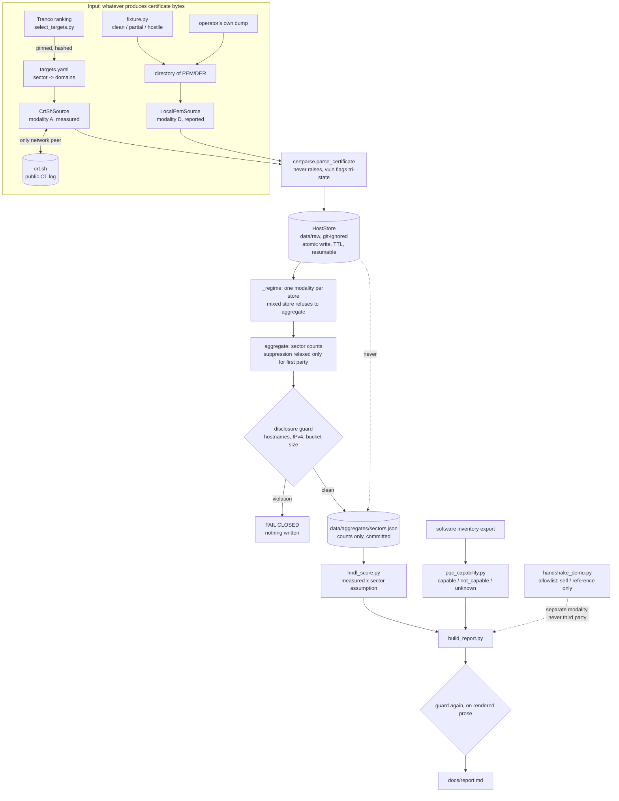

# Architecture

Project codename: ANANKE.

Version 1.0, 2026-08-05.

Three documents, three questions. `docs/METHODOLOGY.md` answers what may be
claimed from the data. `docs/MECHANISMS.md` answers how each mechanism works.
This one answers what talks to what, and where each part is written down. The
runtime sequence lives in `README.md`; what follows is the component view.

The reason for a separate document is the source seam added in v0.9.0. Until
then the pipeline was a line, and a line does not need a component diagram. It
now branches at the first stage and the branch changes the regime everything
downstream operates under, which is exactly the thing a reader loses if the only
picture is a sequence.

## Components

## Where each block is documented

| Block | What it is | Read |
| --- | --- | --- |
| `select_targets.py` | Ranking to target list, pinned and hashed so a run is reproducible; emits a manifest with counts and hashes, never names | `MECHANISMS.md`, selection |
| `CrtShSource` | Third-party estate through public Certificate Transparency. Rate-limited, retried, and the only component that speaks to a third-party service | `MECHANISMS.md`, sources |
| `LocalPemSource` | The operator's own certificates, offline, no network peer. Host identity from the signed subject, never the filename | `MECHANISMS.md`, sources |
| `fixture.py` | Three synthetic estates including two adversarial ones, so the offline path runs before a client exists | `THREAT-MODEL.md`, A3 |
| `certparse.parse_certificate` | PEM or DER to a flat record. Never raises; an unrecognised algorithm resolves to `None`, never `False` | `METHODOLOGY.md`, tri-state convention |
| `HostStore` | One file per host, atomic write, TTL freshness, resumable at host granularity. Git-ignored and never committed | `MECHANISMS.md`, store |
| `_regime` | Resolves one store to one modality, provenance and first-party flag. A store holding two modalities refuses to aggregate | `MECHANISMS.md`, sources |
| `aggregate` | Host records to sector counts. Minimum bucket size relaxed only when a source asserted a first-party estate | `MECHANISMS.md`, disclosure |
| disclosure guard | The scope statement as executable code, on structured output and on committed prose. Fails closed | `MECHANISMS.md`, disclosure; `THREAT-MODEL.md`, A1 |
| `hndl_score.py` | Exposure years against the 2030 milestone, weights from config, sector horizon named as an assumption | `METHODOLOGY.md`, HNDL |
| `pqc_capability.py` | Software inventory to PQC capability, with sourced thresholds and a sourced-negative path for confirmed absence | `MECHANISMS.md`, capability |
| `handshake_demo.py` | The one component that sends packets to a named host, restricted to hosts declared `self` or `reference` | `README.md`, modalities; `THREAT-MODEL.md`, A4 |
| `build_report.py` | Rendered deliverable, passed through the guard again before it lands on disk | `MECHANISMS.md`, reporting |

The table is maintained here rather than in the diagram so a block cannot be
renamed without the row going stale in review.

## Invariants that cross components

**One network peer.** In modality A the only host contacted is `crt.sh`. In
modality D there is none. Anything that adds a peer is an architectural change
and belongs in `THREAT-MODEL.md` before it belongs in code.

**The store never reaches committed output.** Host-level records exist only
under `data/`, which is git-ignored. The path from store to `data/aggregates/`
runs through counting and then through the guard, and there is no other path.

**A source, not a flag, decides the regime.** Provenance, modality and
first-party status are properties of where the data came from. No command-line
argument can assert them, which is what stops suppression being switched off for
third-party data.

**Unknown is not negative.** Tri-state across parsing, capability resolution and
scoring. An unidentified algorithm, an unresolvable version and an absent sector
horizon all resolve to `None` and are reported as unknown, because the failure
mode this project cannot afford is a flattering number nobody questions.
