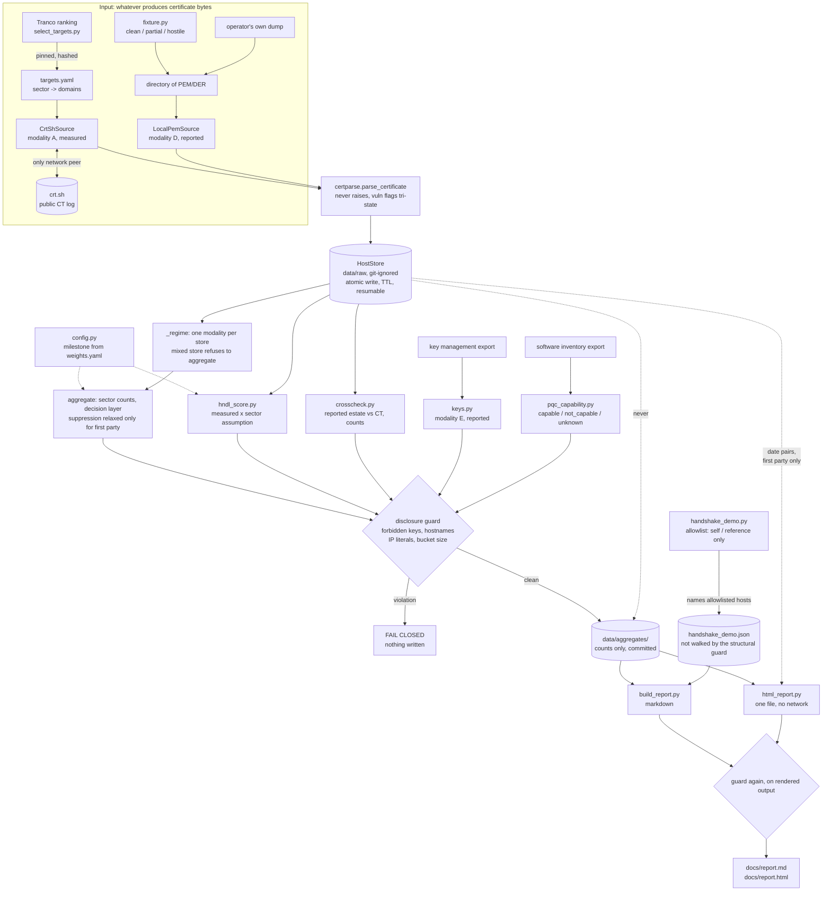

# Architecture

Project codename: ANANKE.

Version 1.1, 2026-11-15. The diagram and the block index now cover the
cross-check, the key inventory, the HTML renderer and the configured milestone,
all of which shipped after version 1.0. The scorer is drawn reading the raw
store, which is what it does; version 1.0 drew it reading the aggregate.

Three documents, three questions. `docs/METHODOLOGY.md` answers what may be
claimed from the data. `docs/MECHANISMS.md` answers how each mechanism works.
This one answers what talks to what, and where each part is written down. The
runtime sequence lives in `README.md`; what follows is the component view.

The document exists because of the source seam added in v0.9.0. Until then the
pipeline was a line. It now branches at the first stage, and the branch decides
the regime everything downstream operates under, which a sequence diagram does
not show.

## Components

## Where each block is documented

| Block | What it is | Read |
| --- | --- | --- |
| `select_targets.py` | Ranking to target list, pinned and hashed so a run is reproducible; emits a manifest with counts and hashes, never names | `MECHANISMS.md` §1 |
| `CrtShSource` | Third-party estate through public Certificate Transparency. Rate-limited, retried, and the only component that speaks to a third-party service | `MECHANISMS.md` §2, §3 |
| `LocalPemSource` | The operator's own certificates, offline, no network peer. Host identity from the signed subject, never the filename | `MECHANISMS.md` §2 |
| `fixture.py` | Three synthetic estates including two adversarial ones, so the offline path runs before a client exists | `THREAT-MODEL.md`, A3 |
| `certparse.parse_certificate` | PEM or DER to a flat record. Never raises; an unrecognised algorithm resolves to `None`, never `False` | `MECHANISMS.md` §3 |
| `HostStore` | One file per host, atomic write, TTL freshness, resumable at host granularity. Git-ignored and never committed | `MECHANISMS.md` §4 |
| `_regime` | Resolves one store to one modality, provenance and first-party flag. A store holding two modalities refuses to aggregate | `MECHANISMS.md` §2 |
| `config.py` | Reads the milestone from `weights.yaml` in one place, so every consumer computes against the same date | `MECHANISMS.md` §5, §7 |
| `aggregate` | Host records to sector counts and the decision layer. Minimum bucket size relaxed only when a source asserted a first-party estate | `MECHANISMS.md` §5 |
| disclosure guard | The scope statement as executable code, on structured output and on committed prose. Fails closed | `MECHANISMS.md` §6; `THREAT-MODEL.md`, A1 |
| `hndl_score.py` | Exposure years against the configured milestone, read from the raw store, weights from config, sector horizon named as an assumption | `MECHANISMS.md` §7 |
| `handshake_demo.py` | The one component that sends packets to a named host, restricted to hosts declared `self` or `reference` | `MECHANISMS.md` §8; `THREAT-MODEL.md`, A4 |
| `pqc_capability.py` | Software inventory to PQC capability, with sourced thresholds and a sourced-negative path for confirmed absence | `MECHANISMS.md` §9 |
| `keys.py` | Key management export to counts, wrapping and signing keys on separate clocks | `MECHANISMS.md` §10 |
| `crosscheck.py` | Reported estate against the same operator's public CT footprint, asymmetric by design, counts only | `MECHANISMS.md` §11; `THREAT-MODEL.md`, A3 |
| `build_report.py`, `html_report.py` | Rendered deliverables, passed through the guard again before they land on disk | `MECHANISMS.md` §13 |

The table lives here rather than in the diagram so a block cannot be renamed
without its row going stale in review. Nothing yet checks that every module is
listed; that check is T27 in `TODO.md`.

## Invariants that cross components

**Named network peers only.** In modality A the only host contacted is crt.sh.
In modality D there is none. Modality B contacts hosts the allowlist declares
and nothing else. Anything that adds a peer is an architectural change and
belongs in `THREAT-MODEL.md` before it belongs in code.

**The store never reaches committed output.** Host-level records exist only
under `data/raw/`, which is git-ignored. The path from store to
`data/aggregates/` runs through counting and then through the guard. The one
sanctioned read outside collection is the HTML horizon chart, which takes
validity date pairs from the store and embeds them for a first-party estate
only (`THREAT-MODEL.md`, B6 and A7).

**A source, not a flag, decides the regime.** Provenance, modality and
first-party status are properties of where the data came from. No command-line
argument can assert them, which is what stops suppression being switched off for
third-party data. The threshold value itself is still an argument (T19).

**Unknown is not negative.** Tri-state across parsing, capability resolution and
scoring. An unidentified algorithm, an unresolvable version and an absent sector
horizon all resolve to `None` and are reported as unknown, because a flattering
number nobody questions is the failure mode this project cannot afford.
